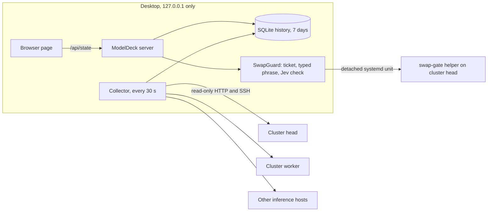

# kodros-modeldeck

A one-page local dashboard for a home model fleet. It shows which models are up, how much GPU memory is free, and how fresh each reading is. Its one action is a cluster model swap that has to pass three checks before it runs.

Part of the [Kodros](https://kodros.ai) local AI stack.

## How it works



The collector reads each service over HTTP and SSH and stores samples in SQLite. Missing or old data shows as offline or stale, never as zero. A swap takes about 3.5 minutes of downtime, so the page makes you:

1. Press Review swap. The server issues a 60-second, single-use ticket tied to the profile and current state.
2. Type `SWAP <profile> WITH 3.5 MINUTE OUTAGE`.
3. Pass a Jev decision check (`jev if ... --state -`). Any answer other than yes blocks the swap.

The swap then runs through the existing `swap-gate` helper, which keeps its own idle, warmup and acceptance checks. ModelDeck never calls the raw gateway swap route and never retries.

## Stack

Python 3.11 standard library only (http.server, sqlite3, threading). Plain HTML, CSS and JavaScript. No third-party packages.

## Run

```sh
python3 -m modeldeck.server --port 8866
# open http://127.0.0.1:8866/
python3 -m unittest discover -s tests -v
```

Live data needs SSH aliases `cluster-a`, `cluster-b`, `build-host` and `client` in `~/.ssh/config`, plus a profile gateway at `MODELDECK_CLUSTER_GATEWAY`. Without them the page loads and marks those sources offline. Full settings and the request flow: [docs/ARCHITECTURE.md](docs/ARCHITECTURE.md).

## Security limits

- Binds to `127.0.0.1` and checks the `Host` header exactly.
- POST needs same-origin headers, a per-process CSRF token, JSON and a 4 KB cap. The browser cannot send a URL, command, host or path.
- A CSP blocks outside scripts and framing.
- Any process running as the same user is trusted. This is not multi-user auth.

## Status

Pre-release. Runs on one Linux desktop. No swap runs in tests or at install. A submitted swap is not proof of success; check live state and the unit journal.

## License

Copyright 2026 Tanner Osterkamp. All rights reserved. See [LICENSE](LICENSE). The source is public to read; ask before reuse.
