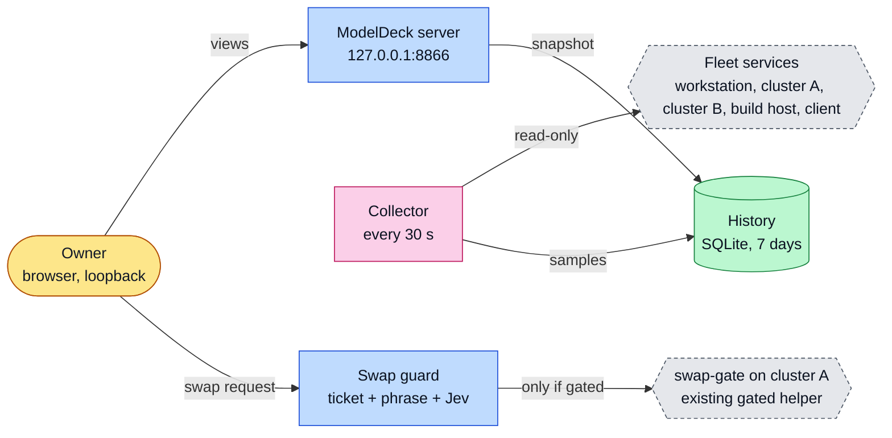
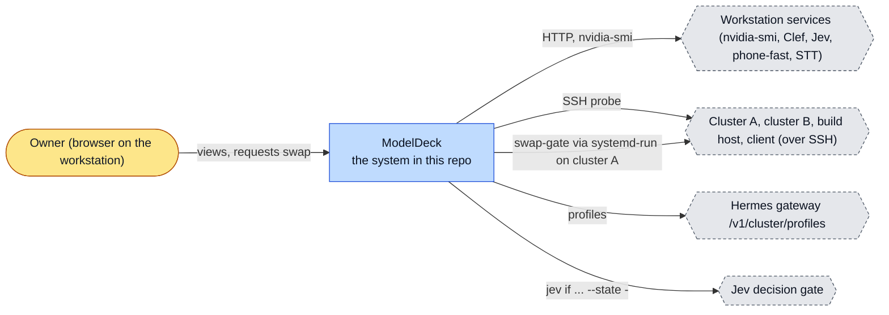
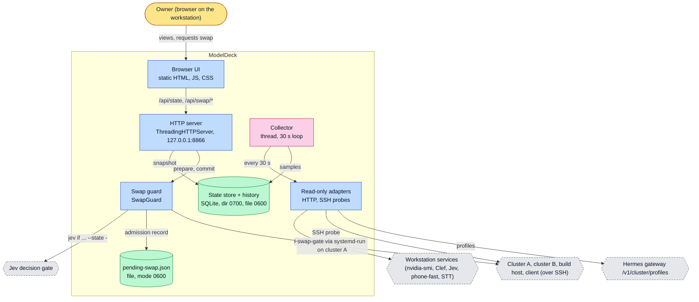
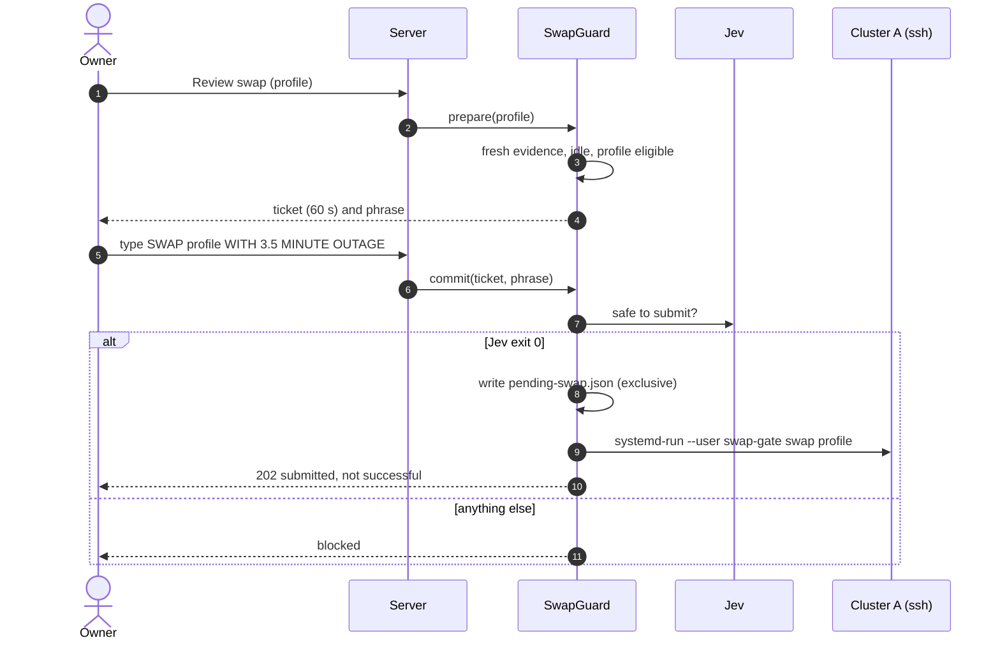
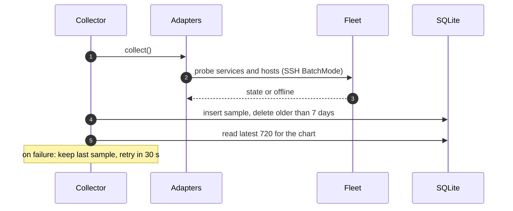
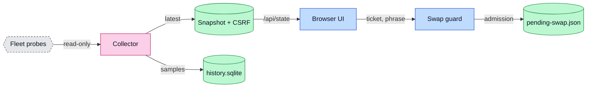
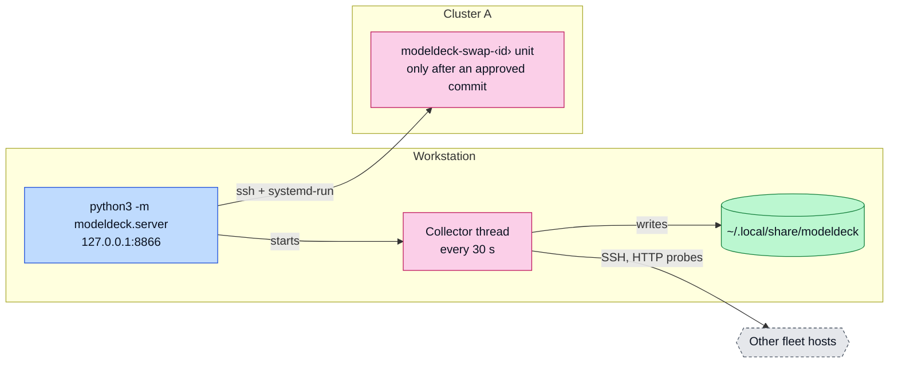
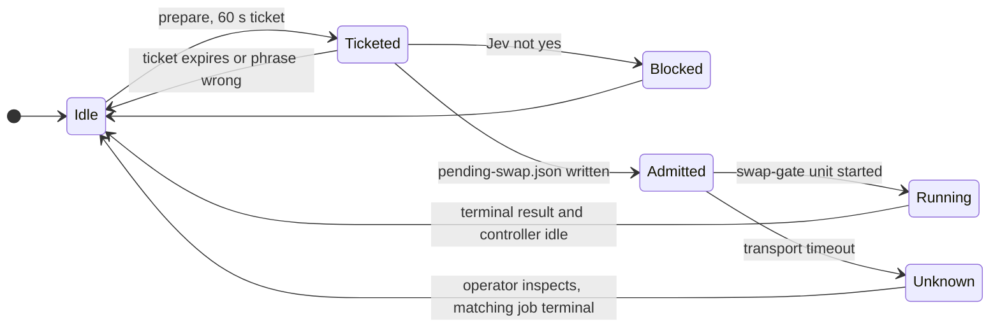

# ModelDeck: architecture

Whiteboard-level structure: what systems exist, what they talk to, and when they run. Each box maps to a file listed in [Evidence](#10-evidence). Diagram sources are Mermaid files in [`architecture/`](architecture/).

Host names used below are role names: **workstation** (runs ModelDeck), **cluster A** (controller and swap helper), **cluster B** (Ollama catalogue), **build host** (model endpoint on a macOS machine) and **client** (second Linux machine with a local model server). Each remote name is an SSH host alias you define in `~/.ssh/config`.

## 1. Purpose

ModelDeck shows which models run where across the fleet: workstation GPU memory and local services, the two-node cluster, the build host and the client. A collector samples every 30 seconds and keeps seven days of history in SQLite. The same page can request a cluster profile swap, but only through a guard: fresh evidence, an idle controller, a single-use 60-second ticket, a typed confirmation phrase and a Jev yes. The swap runs the existing gated helper on cluster A as a detached user unit. ModelDeck never calls the raw gateway swap route.

## 2. Whiteboard view

Seven boxes. Reading the fleet is automatic; changing it takes a human typing a phrase and a Jev yes.

## 3. System context (C4 level 1)

Who and what touches the system from outside.

## 4. Containers and components (C4 level 2)

The parts that run or hold data inside the system boundary.

| Container | Kind | Tech | What it does | Evidence |
|---|---|---|---|---|
| HTTP server | app | ThreadingHTTPServer, 127.0.0.1:8866 | Serves the static UI and `/api/state`. Rejects foreign Host headers; mutations need same-origin, a CSRF token and JSON. | `modeldeck/server.py` |
| Collector | job | thread, 30 s loop | Retries without restart. Offline periods are gaps, not zeros. A failed sample keeps the last data. | `modeldeck/state.py` (`Store.loop`, `Store.collect`) |
| Read-only adapters | app | HTTP, SSH probes | Local service probes, a remote probe script run over SSH with BatchMode, telemetry freshness checks, gateway profile reads. | `modeldeck/adapters.py`, `modeldeck/remote_probe.py` |
| State store + history | store | SQLite, dir 0700, file 0600 | Samples table with 7-day retention. The chart reads the latest 720 samples. | `modeldeck/state.py` (`Store.__init__`, `Store.collect`) |
| Swap guard | app | SwapGuard | `prepare()` issues a 60 s single-use ticket bound to a profile. `commit()` checks the phrase, records admission, then runs the helper. | `modeldeck/guard.py` (`SwapGuard`, `execute_gated`) |
| pending-swap.json | store | file, mode 0600 | Admission record written before SSH. Survives restarts and ambiguity. Cleared only by a fresh terminal job result with the controller idle. | `modeldeck/guard.py` (`SwapGuard`) |
| Browser UI | app | static HTML, JS, CSS | Refreshes every 10 s. Shows offline states, stale labels and the swap dialog. | `modeldeck/static/index.html`, `modeldeck/static/app.js` |

## 5. Key runtime sequences

### 5.1 Reviewing and committing a swap

Any failure at any step leaves the cluster alone. A transport timeout reports an unknown outcome and never retries.

### 5.2 One collector cycle

## 6. Data flow and stores

Credentials stay in the server process. The browser gets state and a CSRF token, never keys or URLs.

| Store | What it holds | Written by | Evidence |
|---|---|---|---|
| history.sqlite | samples(at, payload): one summary per 30 s; 7-day retention. | Collector | `modeldeck/state.py` (`Store.collect`) |
| pending-swap.json | Admission record for an in-flight or ambiguous swap. | SwapGuard before SSH | `modeldeck/guard.py` (`SwapGuard`) |
| In-memory snapshot | Latest hosts, models, cluster, history and the per-process CSRF token. | Collector | `modeldeck/state.py` (`Store`) |

## 7. Deployment and runtime topology

One user process on the workstation, bound to loopback only. The swap runs on cluster A as a detached systemd user unit.

| What | Where | Runs when | Trigger / port | Evidence |
|---|---|---|---|---|
| Collector sample | Workstation | Every 30 s | Wait loop in `Store.loop` | `modeldeck/state.py` |
| Browser refresh | Browser | Every 10 s | `app.js` | `modeldeck/static/app.js` |
| Swap ticket | SwapGuard | Expires after 60 s | `SwapGuard.prepare()` | `modeldeck/guard.py` |
| History retention | SQLite | 7 days | Delete on each sample | `modeldeck/state.py` (`Store.collect`) |

## 8. Failure modes and how to see them

| Failure | What the user sees | How to see it | Evidence |
|---|---|---|---|
| Cluster offline | Profile actions locked; no fresh profiles or logs | Offline state in the UI | [README](../README.md) |
| Foreign Host header or missing CSRF | 403 Foreign Host rejected, or Same-origin and CSRF required | Response body | `modeldeck/server.py` |
| Jev says anything but yes | Submission blocked | Blocked response; Jev exit code | `modeldeck/guard.py` (`jev_gate`) |
| SSH submission times out | Outcome unknown; never retried; pending record remains | `journalctl --user -u modeldeck-swap-<id>` on cluster A | [README](../README.md) |
| Collector error | Last sample retained; retry in 30 s | `collector_error` field in `/api/state` | `modeldeck/state.py` (`Store.loop`) |
| Controller state unknown | No swap: unknown means locked | Eligibility check message | `modeldeck/guard.py` (`SwapGuard`) |

## 9. State machine

Swap request lifecycle in the guard. Submitted is not successful.

## 10. Evidence

Paths are relative to the repository root.

| Path | Why it matters |
|---|---|
| `modeldeck/server.py` | HTTP handler: Host check, CSRF, JSON, swap routes. |
| `modeldeck/guard.py` | Swap guard, Jev gate, gated helper execution. |
| `modeldeck/state.py` | Store, collector and history. |
| `modeldeck/adapters.py` | Probes, telemetry freshness, gateway profile reads. |
| `modeldeck/remote_probe.py` | Script run over SSH on remote hosts. |
| `tests/test_modeldeck.py` | Server and guard tests. |
| `README.md` | What it shows, swap safety, security and limits. |
| `SOURCES.md` | Research sources and license checks. |

The Mermaid files in [`architecture/`](architecture/) are the diagram sources. This document is maintained by hand, so keep it in step with the code when behavior changes.
